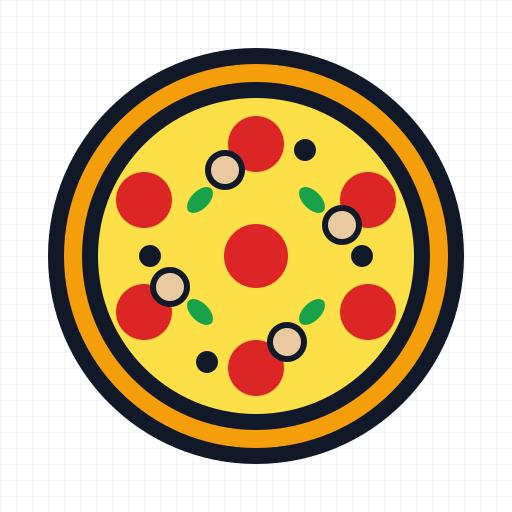
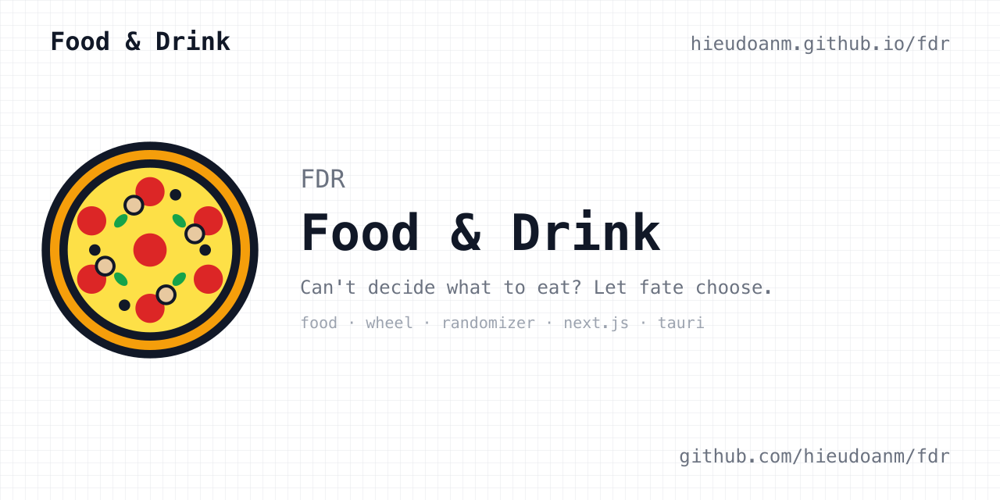

<p align="center">
  
</p>

<h1 align="center">FDR — Food &amp; Drink</h1>

<p align="center"><strong>Can't decide what to eat? Let fate choose.</strong></p>

FDR (Food & Drink) is a small, fast food-picker app: a static Next.js site
with a wheel, a dish randomizer, a searchable menu, and weekly dining
schedules.

<p align="center">
  
</p>

[🚀 Live site](https://hieudoanm.github.io/fdr) · [🔧 Technical docs](./AGENTS.md) · [📖 Product spec](./docs/README.md)

## Features

| Feature              | Route          | What it does                                    |
| -------------------- | -------------- | ----------------------------------------------- |
| **Wheel of Cuisine** | `/wheel/`      | Spin a wheel to pick a country to eat from      |
| **Food Randomizer**  | `/randomizer/` | Spin a reel to pick a dish, filtered by cuisine |
| **Dishes**           | `/dishes/`     | Browse and search dishes across world cuisines  |
| **Food Schedules**   | `/schedule/`   | Weekly dining schedules (Sheldon, Vietnam, UK)  |

The data set covers **200 dishes** across **10 countries** — American, Chinese,
Indian, Italian, Japanese, Korean, Mexican, Thai, Turkish, and Vietnamese — with
drinks, mains, sides, and desserts.

## Monorepo layout

```
.
├── .github/workflows/ci.yaml   # lint → test → build → GitHub Pages deploy
├── docs/                       # product specification (00–12)
├── packages/
│   └── landing/                # FDR: Next.js app + data
│       ├── data/               # CSV sources + generated JSON
│       │   ├── csv/            # foods, countries, schedules
│       │   └── json/           # generated from csv/
│       ├── src/app/            # App Router pages and error boundaries
│       ├── src/components/     # atoms / molecules / organisms / templates
│       ├── src/data/           # typed data access + JSON consumed by the app
│       ├── src/hooks/          # useFoodPicker and friends
│       ├── src/providers/      # service-worker registration
│       └── e2e/                # Playwright specs
├── AGENTS.md                   # technical reference for contributors/agents
└── turbo.json                  # task graph and cache outputs
```

## Getting started

Requirements: Node **26.13.0** (see `.nvmrc`) and pnpm **12.16.1**.

```bash
pnpm install
pnpm dev          # http://localhost:3000
```

Root scripts fan out through Turborepo:

| Command          | Description                                               |
| ---------------- | --------------------------------------------------------- |
| `pnpm dev`       | Development server                                        |
| `pnpm build`     | Production build; static export in `packages/landing/out` |
| `pnpm lint`      | ESLint across the workspace                               |
| `pnpm typecheck` | `tsc --noEmit` across the workspace                       |
| `pnpm test`      | Jest unit tests with 80% coverage thresholds              |
| `pnpm format`    | Prettier, writing changes                                 |

Run a single package's script with pnpm's filter:

```bash
pnpm --filter @fdr/landing test
pnpm --filter @fdr/landing test:e2e     # builds, then runs Playwright on out/
pnpm --filter @fdr/landing start        # serves out/ on :3000
```

## Data model

The canonical data is CSV in `packages/landing/data/csv/`; JSON in
`packages/landing/data/json/` is generated from it. The app imports a checked-in
copy from `packages/landing/src/data/json/` — `csv-to-json.mjs` writes both:

```bash
node packages/landing/data/csv-to-json.mjs
```

| File                          | Records | Shape                                                 |
| ----------------------------- | ------- | ----------------------------------------------------- |
| `foods.csv`                   | 200     | `country, category, subcategory, value, label, emoji` |
| `countries.csv`               | 10      | `value, label, emoji`                                 |
| `schedule-scheldon.csv`       | 7       | `day, meal, emoji, restaurant, note`                  |
| `schedule-vietnam.csv`        | 14      | `day, week, meal, emoji, restaurant, note`            |
| `schedule-united-kingdom.csv` | 7       | `day, meal, emoji, restaurant, note`                  |

`packages/landing/src/data/` exposes the typed accessors:

- `Food`, `Cuisine`, `ScheduleEntry`, and `ScheduleMeta` types
- `foods`, `countries`, `schedules`, `getSchedule`, `listSchedules`
- `FOOD_OPTIONS` — label lists keyed by country, dish value, and `all`

## Deployment

`.github/workflows/ci.yaml` runs on every push and pull request to `master`:

1. **Typecheck**, **lint**, and **test**.
2. **Build** with `BASE_PATH=/fdr`, producing `packages/landing/out`.
3. Upload the static export as a Pages artifact.
4. On `master` (push or manual dispatch), **deploy** to GitHub Pages.

Set the repository's **Settings → Pages → Source** to **GitHub Actions** once;
the workflow cannot configure that itself. The site is served from
`https://hieudoanm.github.io/fdr`.

## License

[MIT](./LICENSE) © 2026 Hieu Doan
